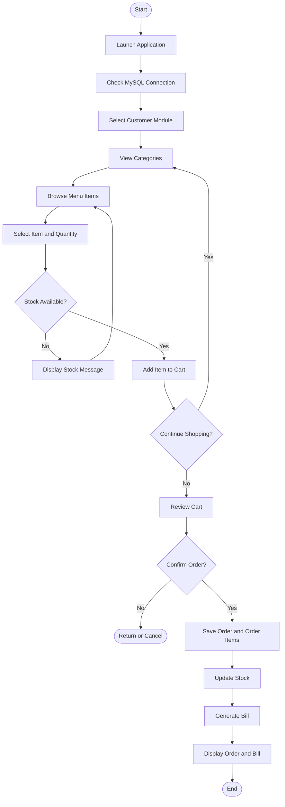
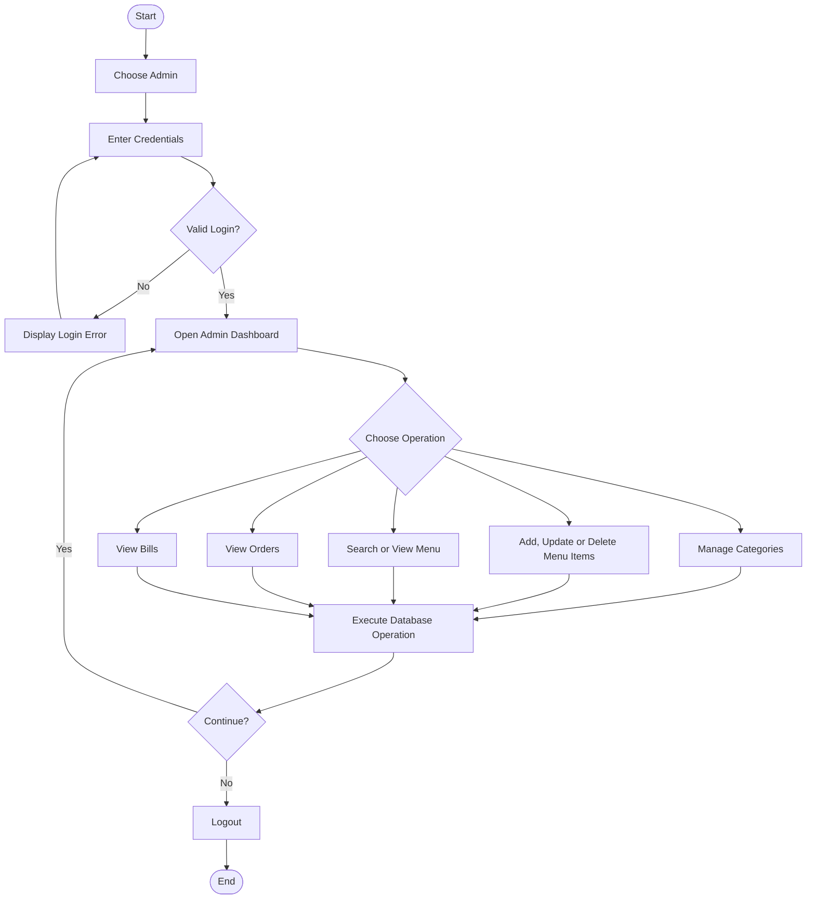

# 🍦 Ice Cream Parlour Management System

A console-based **Ice Cream Parlour Management System** developed using Core Java, JDBC, and MySQL. The project helps manage ice cream categories, menu items, customer orders, inventory, and billing through a structured Java application.

The updated version introduces the **Data Access Object (DAO) design pattern**, separating database operations into dedicated DAO classes to improve code organization, maintainability, and reusability.

## 📌 Project Overview

The Ice Cream Parlour Management System is designed to simplify the daily operations of an ice cream parlour. Customers can browse menu categories, view product details, search for menu items, add products to a cart, place orders, and receive bills.

Administrators can log in to manage menu categories and products, update or delete menu items, and view orders and bills.

The application connects to a MySQL database using JDBC and performs database operations through Java classes and DAO components.

## 🎯 Project Objectives

- Simplify ice cream menu and category management.
- Provide an organized customer ordering process.
- Calculate order totals and generate bills.
- Update product stock when orders are placed.
- Restrict administrative operations through admin login.
- Organize database operations using the DAO design pattern.
- Maintain persistent application data in MySQL.

## ✨ Key Features

### 👤 Customer Module
- View available menu categories.
- Browse menu items by category.
- View item names, flavours, prices, descriptions, and available stock.
- Search for menu items.
- Add multiple items and quantities to a shopping cart.
- Review the cart before checkout.
- Place orders and receive an order ID.
- Generate a bill automatically after a successful order.

### 🔐 Admin Module
- Admin login and logout.
- View available menu items.
- Add and manage menu categories.
- Add new menu items.
- Update existing menu items.
- Delete menu items.
- Search for menu items.
- View customer orders and order status.
- View generated bills.

### 📦 Inventory Management
- Maintain menu item quantities.
- Validate requested quantities against available stock.
- Update inventory after a successful order.
- Help prevent orders exceeding available stock.

### 🧾 Billing and Order Management
- Calculate the total order amount.
- Store order details and individual order items.
- Generate bills associated with orders.
- Retrieve bill information using bill or order IDs.

## 🆕 What's New in This Version?

The updated version introduces the **DAO (Data Access Object) pattern**, which was not implemented in the earlier version of this project.

DAO classes centralize database-related operations instead of placing all SQL logic directly in application classes.

The main DAO components are:

- `AdminDAO` — handles admin authentication queries.
- `MenuCategoryDAO` — manages menu category database operations.
- `MenuItemDAO` — handles menu item CRUD and search operations.
- `OrderDAO` — manages order placement, order items, and stock updates.
- `BillDAO` — handles bill creation and bill retrieval.

This architectural improvement makes the project easier to understand, maintain, test, and extend.

**Database note:** The DAO pattern is implemented in Java and does not, by itself, require changes to the MySQL schema. The existing database must still contain the tables and columns expected by the updated SQL queries.

## 🛠️ Technologies Used

| Technology | Purpose |
|---|---|
| Core Java | Application logic and console interface |
| JDBC | Java-to-MySQL connectivity |
| MySQL | Persistent data storage |
| SQL | Data retrieval and manipulation |
| DAO Design Pattern | Separation of database access logic |
| Eclipse IDE | Java development environment |

## 🏗️ Project Architecture

The application follows a layered organization:

1. **Presentation Layer** — displays menus and collects user input.
2. **Application Layer** — coordinates customer ordering, administration, and billing.
3. **DAO Layer** — performs database operations through dedicated DAO classes.
4. **Database Layer** — stores categories, menu items, orders, order items, and bills in MySQL.

### Architecture Flow

```text
             CUSTOMER / ADMIN
                    |
                    v
             Main.java
                    |
          +---------+---------+
          |                   |
          v                   v
   Customer Module       Admin Module
          |                   |
          v                   v
   OrderIceCream       AdminDashboard
          |                   |
          +---------+---------+
                    |
                    v
             DAO Classes
          /      |       \
         v       v        v
     MenuItem  OrderDAO  BillDAO
       DAO
         \       |        /
          \      |       /
                 v
           JDBC Connection
                 |
                 v
              MySQL DB
```

## 📂 Project Structure

```text
IceCreamParlour/
│
├── src/
│   ├── DAO/
│   │   ├── AdminDAO.java
│   │   ├── BillDAO.java
│   │   ├── MenuCategoryDAO.java
│   │   ├── MenuItemDAO.java
│   │   └── OrderDAO.java
│   │
│   ├── project/
│   │   ├── Main.java
│   │   ├── DBConnecton.java
│   │   ├── MenuItems.java
│   │   ├── AdminLogin.java
│   │   ├── AdminDashboard.java
│   │   ├── AddIceCream.java
│   │   ├── ViewIceCream.java
│   │   ├── UpdateMenuItem.java
│   │   ├── DeleteMenuItem.java
│   │   ├── SearchMenuItem.java
│   │   ├── OrderIceCream.java
│   │   ├── Bill.java
│   │   └── TestConnection.java
│   │
│   └── module-info.java
│
├── .gitignore
└── README.md
```

## 🗂️ DAO Class Responsibilities

| DAO Class | Responsibility |
|---|---|
| `AdminDAO` | Checks administrator credentials against the database. |
| `MenuCategoryDAO` | Adds, retrieves, updates, and deletes categories. |
| `MenuItemDAO` | Adds, lists, searches, updates, and deletes menu items. |
| `OrderDAO` | Saves orders and order items and updates stock. |
| `BillDAO` | Generates and retrieves bill records. |

## 🔄 Application Workflow

1. The application starts through `Main.java`.
2. The system checks the database connection.
3. The user chooses the Customer or Admin module.
4. Customers browse categories and available products.
5. Customers select products and enter quantities.
6. The application validates stock and displays the cart.
7. The customer confirms checkout.
8. The order and its items are saved in MySQL.
9. Stock quantities are updated as part of order processing.
10. A bill is generated for the successful order.
11. The customer receives the order and billing information.
12. Administrators can log in separately to manage menu items, categories, orders, and bills.

## 🔀 Customer Ordering Flowchart



## 🔐 Admin Workflow



## 🧠 What Is DAO?

DAO stands for **Data Access Object**. It is a design pattern used to separate database operations from the rest of an application.

For example, instead of writing menu item SQL queries throughout the application, the application can call a method such as:

```java
menuItemDAO.getAllMenuItems();
```

The DAO class contains the SQL query and handles the database interaction. The calling class can focus on the application workflow.

### Benefits of DAO

- Separation of concerns.
- Reusable database operations.
- Cleaner application classes.
- Easier maintenance and debugging.
- Better organization of SQL queries.
- Easier unit testing when dependencies are designed for it.

## 🗄️ Database

The application uses MySQL for persistent storage. The updated code contains queries for these logical data areas:

- `menu_categories` — menu categories.
- `menu_items` — menu item details and stock.
- `orders` — order-level information.
- `order_items` — products and quantities belonging to an order.
- `bills` — generated billing records.
- `admin` — administrator login information.

**Important:** These are the table names referenced in the uploaded source code. Verify them against your actual existing MySQL database before publishing setup instructions. This README does not assume that the existing schema has been migrated or changed.

## ⚙️ Setup and Installation

### Prerequisites

- Java Development Kit (JDK).
- Eclipse IDE or another Java IDE.
- MySQL Server.
- MySQL Workbench.
- MySQL Connector/J JDBC driver.

### Steps

1. Clone or download this repository.
2. Import the project into Eclipse as an existing Java project.
3. Install and configure MySQL Server.
4. Open your existing `IceCreamParlour` database in MySQL Workbench.
5. Verify that the existing tables and columns match the SQL queries in the Java source.
6. Configure the database URL, username, password, and JDBC driver securely.
7. Run `TestConnection.java` if you want to check database connectivity.
8. Run `Main.java` to start the application.
9. Choose the Customer or Admin module from the console menu.

### Database Connection

The application uses JDBC to connect to MySQL. Configure the connection settings for your local environment; do not commit real database passwords or other credentials to GitHub.

## 🔒 Security Considerations

- Do not commit database passwords or private credentials.
- Store local database configuration outside tracked source files.
- Use prepared statements for SQL operations involving user input.
- Keep administrative functionality restricted to authenticated administrators.
- For production use, store passwords securely using a password-hashing approach rather than plain-text comparisons.

## 🚀 Future Enhancements

- Add a graphical user interface.
- Introduce sales reports and analytics.
- Add more detailed stock alerts.
- Improve exception handling and application logging.
- Add automated unit and integration tests.
- Improve admin authentication and password security.
- Add customer order history and reporting.

## 🎓 Learning Outcomes

This project demonstrates practical knowledge of:

- Java classes, objects, and methods.
- JDBC database connectivity.
- SQL CRUD operations.
- Prepared statements and result sets.
- DAO architecture and separation of concerns.
- Menu-driven application development.
- Inventory and order processing.
- Transaction-oriented database operations.

## 👨‍💻 Project Information

**Project Name:** Ice Cream Parlour Management System

**Programming Language:** Java

**Database:** MySQL

**Database Connectivity:** JDBC

**Architecture Concept:** Data Access Object (DAO) Design Pattern

**Previous Version:** [Ice-Cream-Parlour](https://github.com/gurusaranchandru-dev/Ice-Cream-Parlour)

---

If you find this project useful for learning Java, JDBC, MySQL, and DAO architecture, feel free to explore the source code and suggest improvements.
# Ice-Cream-Parlour-Management-System
